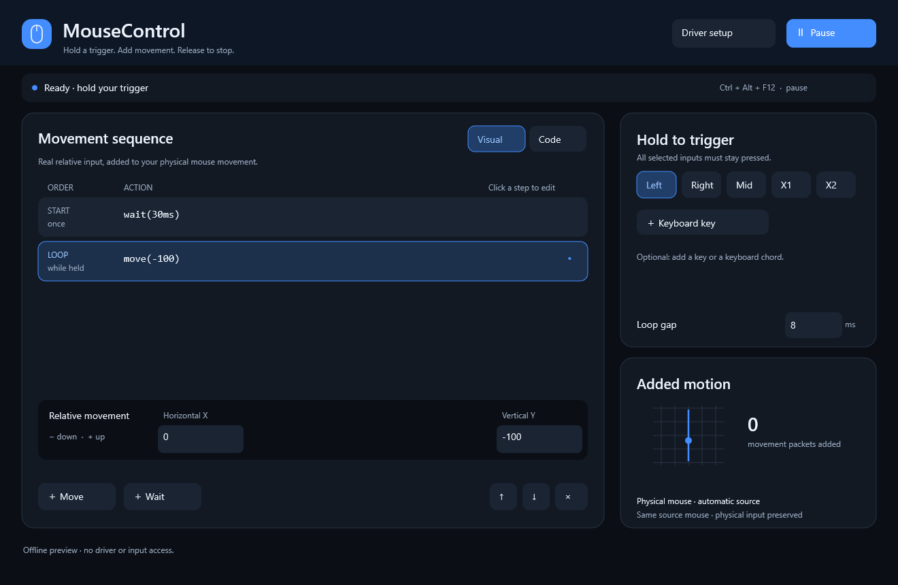

# MouseControl

**Hold a keyboard/mouse trigger to add a movement sequence to your physical mouse. Release it to stop.**

A small, native C++ Windows app built with the **[Interceptor Keyboard & Mouse](https://github.com/TitanCSA/Interceptor-Keyboard-Mouse) demo driver**. Movements travel through the selected physical mouse's driver path; your normal mouse movement, clicks, wheel and keyboard input continue to pass through.

**[Download MouseControl](https://github.com/TitanCSA/MouseControl/releases/latest)** · [Driver and SDK](https://github.com/TitanCSA/Interceptor-Keyboard-Mouse) · [Build](#build-from-source)


*Offline rendering of the actual interface; preview values are illustrative.*

## Start in three steps

1. Download and extract **MouseControl-1.0.0-Windows-x64.zip**.
2. Run the included **InterceptorSetup.exe**, select **Install / reinstall**, and use Windows **Restart** if requested. Use this Keyboard & Mouse edition, rather than an overlapping combined Interceptor installation.
3. Open **MouseControl.exe** and accept the administrator prompt. It starts ready. Click outside the MouseControl window, then hold **left mouse**.

If the driver is missing, unavailable or expired, the app explains the problem. **Driver setup** opens the verified installer beside the app; **Retry** reconnects after setup. No driver is silently installed. Windows 10 1709+ / Windows 11 **x64** is required.

## The default sequence

```text
wait(30ms)

loop {
    move(-100)
}
```

Hold left click: wait 30 ms, then repeatedly add downward mouse movement. Release left click: cancel the wait or the running loop. A new hold starts again from the beginning. The default **Loop gap is 8 ms**; set 1–1000 ms in the UI. An empty/busy loop never consumes a CPU core.

**Values are relative device counts, not guaranteed screen pixels.** Mouse sensitivity, pointer acceleration and application settings determine the visible distance. Script coordinates deliberately use **negative Y for down**, so `move(-100)` matches the default above.

| Command | Meaning |
|---|---|
| `move(-100)` | Add 100 vertical counts downward. |
| `move(50)` | Add 50 vertical counts upward. |
| `move(20, -5)` | Add 20 counts right and 5 down. |
| `wait(30ms)` or `wait(30)` | Wait 30 ms; release still cancels immediately. |
| `loop { ... }` | Repeat while every trigger remains held. |

Place one-time commands before the optional final `loop`. Comments start with `//`. Movement values are whole numbers from −1,000,000 to 1,000,000; waits are 0–600,000 ms. Each section supports up to 64 steps. Loop gap is added at the end of each cycle, after any explicit waits.

## Change the action

- **Visual:** click a step, edit X/Y or its wait, add movements/waits, and use the arrow/delete buttons to arrange the sequence.
- **Code:** edit the same sequence directly. Valid changes take effect automatically; invalid text shows a line error and leaves the last valid sequence in use. Switch between the two views at any time.
- **Trigger:** select Left, Right, Middle, X1 and/or X2; add keyboard keys with **Keyboard key**, then press the key. Escape cancels recording; click a recorded key to remove it. All selected inputs are required together. For left + right, both buttons must be held **on the same mouse**.
- **Pause:** use the top button or **Ctrl+Alt+F12**. Pausing/closing releases capture. Actions are suspended while MouseControl is the foreground window so you can edit safely.

With a mouse-button trigger, the added movements always use the mouse that satisfied the chord. With a keyboard-only trigger, move the intended mouse first: the last mouse seen by the capture is selected and remains fixed until release. No virtual replacement mouse is created.

Settings save automatically to `%LOCALAPPDATA%\MouseControl\preferences.mcontrol`. Pressed keys are held only in memory for trigger matching; the app does not save a keyboard activity log. There are no application accounts, licensing requests or background updater.

## Driver demo and full version

The app's source is MIT-licensed. Its underlying **Interceptor Keyboard & Mouse demo allows one hour per Windows kernel boot**, shared with other apps using that edition, beginning at its first capture. When the allowance expires, the driver releases capture and physical input passes through. Use **Windows Restart** to start a new allowance; reopening the app does not reset it.

> **Want the full driver without the demo time limit?**
>
> Add **`titancsa`** on Discord: **Friends → Add Friend → `titancsa`**, then send a message mentioning **Interceptor Keyboard & Mouse / MouseControl**.

This project demonstrates what can be built with the two-file SDK. The Microsoft-signed driver is distributed as a precompiled installer; **no kernel source is included**. Microsoft signing of the driver does not sign or certify MouseControl itself.

## How it works

```cpp
auto inputs = Interceptor::Get_Input_With_Timeout(timeout, wake);
// Track the physical trigger state, then forward the original batch unchanged.
Interceptor::Send_Input(inputs);

// When the sequence is due and its trigger is still held:
Interceptor::Mouse_Input movement{};
movement.device = sourceMouse;
movement.stroke.x = x;
movement.stroke.y = y; // Windows coordinates: +Y is down.
Interceptor::Send_Input(movement);
```

See [App/Engine.cpp](App/Engine.cpp) for checked sends and cleanup, and [App/Core.cpp](App/Core.cpp) for the bounded scheduler. A single capture worker waits for driver input or a configuration/stop event; it performs no polling when idle. Physical packets are processed and forwarded before a new synthetic packet is considered. There is no queue of future movements to drain after release. Already accepted Windows packets cannot be recalled. Millisecond timing is best effort under Windows scheduling, not a hard real-time guarantee.

Support follows the driver's associated keyboard/mouse paths. This is relative pointer movement, not an absolute touchscreen/touchpad emulator, and compatibility with every device or application is not guaranteed. Close other apps that capture the same devices.

## Build from source

Install Visual Studio 2022 **Desktop development with C++**, a Windows SDK, and CMake. Run:

```powershell
.\Build.ps1                  # Build, offline tests, and portable ZIP
.\Build.ps1 -Target Build    # Build only
.\Build.ps1 -Target Test     # Repeat offline tests
.\Build.ps1 -Render          # Also render the documentation screenshot
.\Build.ps1 -AddressSanitizer -Target Test # Test an existing sanitizer build
```

For the first sanitizer build, use `-AddressSanitizer -Target Build`, then test it. The bundled SDK consists of **Interceptor.cpp + Interceptor.h**. No DLL, Qt, Electron, Node.js, .NET or kernel build is needed. Packaging fetches only the pinned official driver installer if it is absent and verifies its SHA-256 before including it.

Offline tests cover parsing, timing, multi-mouse/keyboard chords, release cancellation, physical forwarding, pause/focus, failure cleanup and the real UI. Preview without a driver with `MouseControl.exe --preview`.

## Responsible use

Created for legitimate input automation, accessibility and SDK experimentation on computers you are authorized to control. You are responsible for how you use the software and for compliance with applicable laws and application rules. Provided **as is**, without a warranty; the author is not responsible for misuse or unlawful activities. See [LICENSE](LICENSE) and the [driver binary terms](Interceptor/BINARY-LICENSE.txt).
